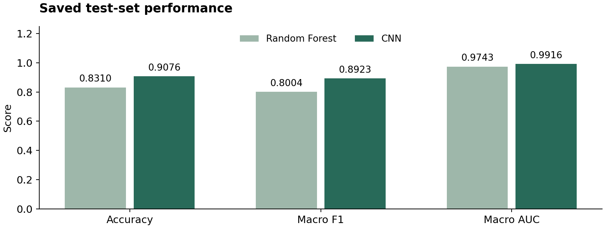

# BloodMNIST Image Classification

**A Random Forest baseline and a compact PyTorch CNN for eight-class blood cell classification.**

[Read the report](reports/bloodmnist-report.pdf) · [CNN notebook](01_cnn.ipynb) ·
[Random Forest notebook](02_random_forest.ipynb) · [Validation and provenance](docs/VALIDATION.md)



## Project overview

This course project compares a pixel-based Random Forest with a two-block
convolutional neural network on BloodMNIST. Images are **28 × 28 RGB**, with eight
cell types. The saved analysis used 11,959 training and 3,421 test images.

## Results recorded in the original notebooks

| Model | Test accuracy | Macro F1 | Macro one-vs-rest AUC |
|---|---:|---:|---:|
| Random Forest | 83.10% | 0.8004 | 0.9743 |
| CNN | 90.76% | 0.8923 | 0.9916 |

The CNN improved accuracy by 7.66 percentage points in the saved run. Class-level
performance was uneven: monocytes and immature granulocytes remained harder to
classify. These are archived results, not a newly trained evaluation.

## Methods

- **Random Forest:** flatten RGB pixels after conversion to [0, 1]; 100 trees,
  `random_state=42`.
- **CNN:** 3→32→64 convolution channels, ReLU and max pooling after each block,
  a 128-unit hidden layer and eight output logits.
- **Training:** Adam, learning rate 0.001, batch size 128, ten epochs, ordinary
  unweighted cross-entropy loss; RGB channels normalized with mean/SD 0.5.
- **Evaluation:** accuracy, macro F1, macro one-vs-rest AUC and per-class metrics.

The cleaned CNN sets seed 123 for future runs. The original notebook did not fix
the Torch seed, so its exact scores are not guaranteed to recur. This baseline
does not tune hyperparameters or select checkpoints using the validation split;
future development should use the official validation split and reserve the test
set for final evaluation.

## Run locally

Use Python 3.10 or newer in a virtual environment. From the repository root:

```bash
python -m venv .venv
# macOS/Linux: source .venv/bin/activate
# Windows PowerShell: .venv\Scripts\Activate.ps1
python -m pip install -r requirements.txt
jupyter lab
```

Open either root-level notebook and run all cells in order. MedMNIST downloads
the dataset on first use, so internet access is required. The CNN defaults to
CPU execution for portability. PyTorch installation may need platform-specific
instructions from [pytorch.org](https://pytorch.org/get-started/locally/).

Each notebook writes new aggregate metrics to `results/rerun/`. Its displayed
outputs were cleared during cleanup; archived outputs remain in `archive/`.
Package requirements are not an exact environment lockfile.

## Repository guide

| Path | Contents |
|---|---|
| `01_cnn.ipynb`, `02_random_forest.ipynb` | Clean analysis entry points |
| `results/reference/` | Metrics transcribed from the saved original outputs |
| `reports/bloodmnist-report.pdf` | Portfolio report |
| `figures/` | Sample image and aggregate result figures |
| `archive/` | Unmodified original notebooks, README and image |
| `scripts/render_report.py` | Rebuild the clean report and figures from aggregate CSVs |
| `docs/` | Cleanup notes, verification limits and upload instructions |

To regenerate the report without downloading data or training models:

```bash
python -m pip install -r requirements-report.txt
python scripts/render_report.py
```

## Provenance and limitations

Source: [jengithubb/DermaMNIST-CNN-project](https://github.com/jengithubb/DermaMNIST-CNN-project),
commit `243db78f2b288da6c82f1173ec1115cc66386282`. Despite the old repository name,
the notebooks analyze **BloodMNIST**, not DermaMNIST.

The original README's 90.1% CNN accuracy and weighted-loss claim were inconsistent
with the executed notebook. This edition uses its saved 90.76% result and the
unweighted training loss. Original material and attribution are retained in the
archive. No new clinical validation, training run or confidence intervals are claimed.

Data and benchmark: [MedMNIST](https://medmnist.com/). Dataset usage and citation
requirements remain with the original data source. Downloaded data and model
weights are not bundled.
